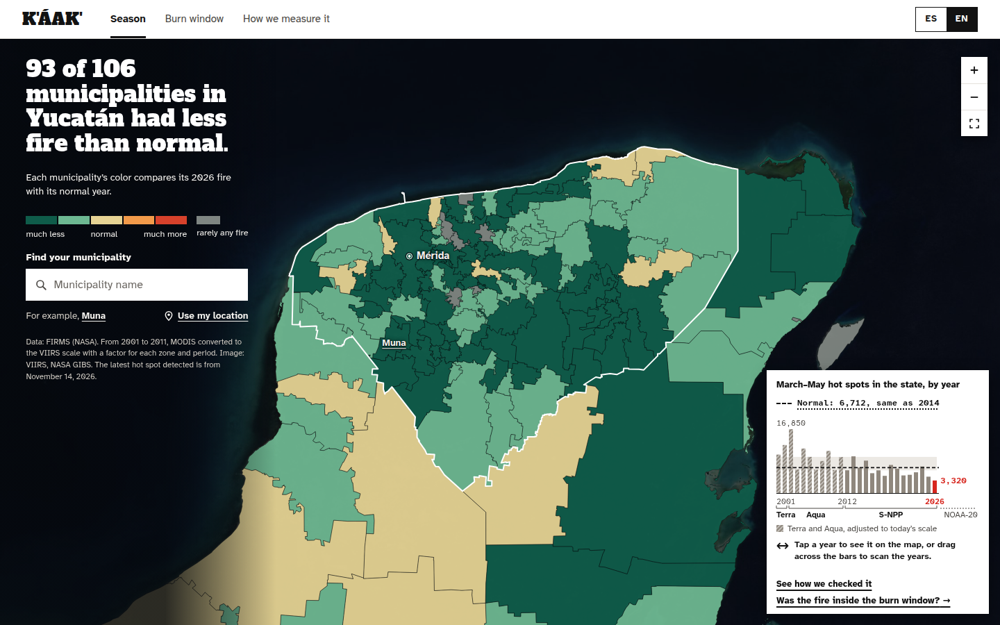
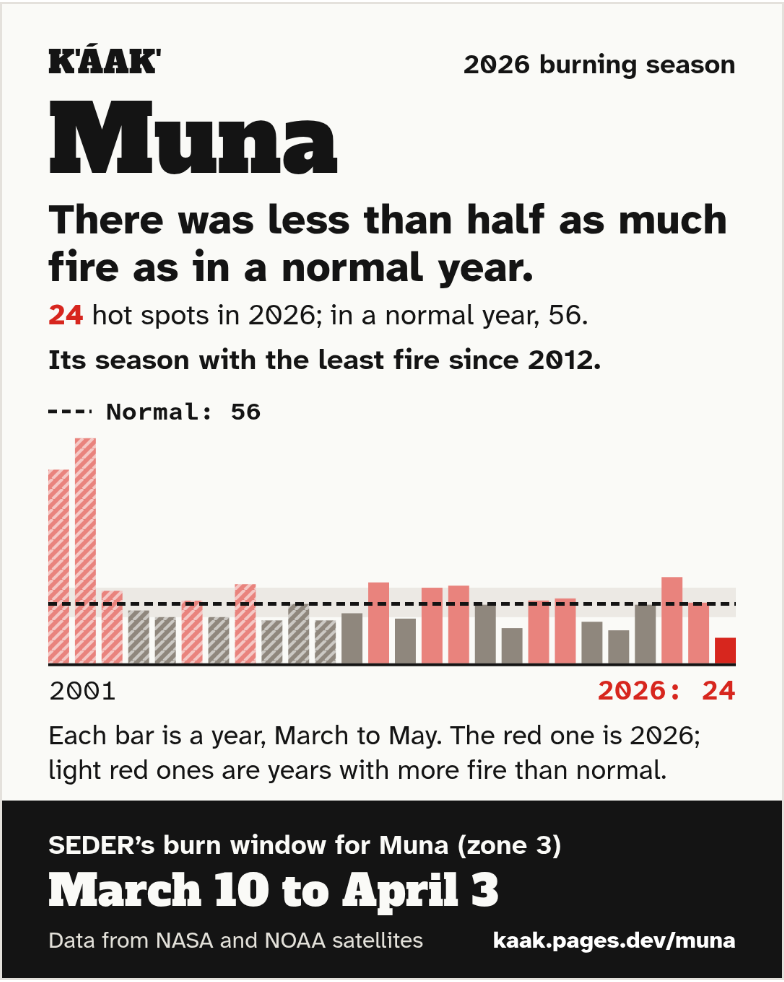

# K'áak'

*The fire calendar of the Yucatán Peninsula, seen from space.*

Project for the **NASA Space Apps Challenge 2026** (Mérida host site, November 13–15), challenge
[Harmonization of MODIS and VIIRS Hot Spots](https://www.spaceappschallenge.org/2026/challenges/modis-and-viirs-hot-spots/).
*K'áak'* means "fire" in Yucatec Maya.

Live site: <https://kaak.pages.dev>





Each municipality gets a page and a card like Muna's, on the right, that a local authority can
forward by WhatsApp. The site is in Spanish and English.

<br clear="right">

## What it does

K'áak' joins 25 years of satellite fire detections (MODIS and VIIRS) into a single comparable
series. With it, state agencies, civil protection and rural communities can tell whether the
burning season in their municipality is worse than normal, when burning really happens, and
where it recurs year after year.

- **One series, four satellites.** MODIS (Terra, Aqua) and VIIRS (S-NPP, NOAA-20) are put on
  the VIIRS scale with a MODIS→VIIRS factor per burn zone and time of year, and validated with
  three tests and a comparison with CONAFOR's ground records. Not all four are independent of the
  calibration (the NOAA-20 check uses the same years as its factor, and CONAFOR measures detection,
  not the factor), but the 2012 jump test holds even with the factors calibrated only on
  2016–2020, without 2013–2015: harmonized ratio ≈ 0.908, against 0.904 with the current factors.
  NOAA-21 also observes the peninsula, but it is not part of the series.
- **A calendar per municipality.** Year against year and day by day, how today's season
  compares with the 25-year normal.
- **Official burn windows.** Fire detections are crossed with the state's official burning
  calendar by zone.
- **Where it burns.** Each municipality page maps the 1 km squares where fire has recurred in
  five or more seasons since 2012, and every 2026 hot spot with its date and satellite.
- **Cattle land.** For Yucatán, pasture, cattle and hot spots on pasture by municipality
  (INEGI).
- **A shareable sheet.** Each municipality has a downloadable summary that a community leader
  can forward by messaging app.

K'áak' does not predict fires and is not an official alert system. A satellite does not see
all fire, and no detections does not mean no fire. "Normal" is a reference, not a target.

## Repository layout

| Path | Contents |
|---|---|
| `web/` | The static site (HTML, CSS and JavaScript with no libraries: an SVG map over a cloud-free satellite mosaic, and SVG charts), published on Cloudflare Pages |
| `pipeline/` | Python code that turns the harmonized series into the files the site reads |
| `analisis/` | Scripts that download and prepare the raw data and reproduce the figures |
| `datos_peninsula/` | Ready-to-use fire detections, CONAFOR fire records and boundaries for the peninsula (25 MB). See [its guide](datos_peninsula/README.md) |
| `tests/` | Automated tests, run on every pull request (ruff, pytest, and Playwright with axe-core for the site in `tests/web/`) |
| `docs/` | Project documentation in English. The Spanish originals are in `docs/es/` |

## Documentation

The documentation is in English. The Spanish versions are in [docs/es/](docs/es/). Terms are fixed
in the [glossary](docs/GLOSSARY.md).

1. [Verified facts](docs/01-verified-facts.md): fire figures and their sources.
2. [Method](docs/02-method.md): what the site does, the method and each task.
3. [Pitch script](docs/03-script.md): the in-person presentation at the Mérida host site, in Spanish. The global submission is this repository, the site and the 30-second video.
4. [The countryside and fire](docs/04-countryside-and-fire.md): who burns, why it matters and the fire calendar of each municipality.
5. [Explained simply](docs/05-explained-simply.md): the problem and the solution in plain words, and the four lines for the jury.

## Getting started

Requires Python 3.11+.

```bash
python -m venv .venv
.venv/bin/pip install -r requirements.txt
.venv/bin/pytest -q
```

The site has no build step: `python -m http.server -d web` serves it. Its tests need Node 20:

```bash
npm ci
npx playwright install chromium
npx playwright test                       # desktop and phone, axe-core, both languages
node tests/web/recorrido.mjs <name> fechas   # walkthrough video (MP4) for a pull request; needs ffmpeg
```

Pull request videos are uploaded as GitHub attachments, so they play inside the pull request:
`gh pr edit <n> --body-file body.md --attach videos/<name>-escritorio.mp4` with gh 2.99 or later.

To rebuild the peninsula dataset from raw data:

```bash
./analisis/descargar_datos.sh                      # ~900 MB into data/ (not tracked by Git)
.venv/bin/python analisis/preparar_peninsula.py    # builds datos_peninsula/
FIRMS_MAP_KEY=your_key .venv/bin/python analisis/descargar_firms_api.py   # latest FIRMS data
```

A NASA FIRMS map key is free: <https://firms.modaps.eosdis.nasa.gov/api/map_key/>. Never commit
it; pass it as an environment variable (the daily update uses the `FIRMS_MAP_KEY` repository
secret).

## Data sources

- [NASA FIRMS](https://firms.modaps.eosdis.nasa.gov/): MODIS and VIIRS active fire detections.
- CONAFOR forest fire records (datos.gob.mx).
- Official burning calendar of SEDER (Yucatán).
- [geoBoundaries](https://www.geoboundaries.org/) (CC BY 4.0) and Natural Earth: boundaries.
- [NASA GIBS](https://nasa-gibs.github.io/gibs-api-docs/): VIIRS Corrected Reflectance (True Color)
  tiles from NOAA-20, Suomi NPP and NOAA-21, combined into the cloud-free satellite image of the peninsula.
- INEGI: Land Use and Vegetation map, Series VII (2018), and Agricultural Census 2022, for the
  cattle land of each municipality.

Each figure is traced to its source in [docs/01](docs/01-verified-facts.md).

## Use of AI (required disclosure for Space Apps)

Space Apps calls AI tools "Super Intelligence" (SI) and asks every team to say where and how it
used them, including in code and data. We used Claude (Anthropic) for research (source search,
the scripts in `analisis/`, including the cross-check against CONAFOR records in
`analisis/cruce_conafor.py`), to draft code that a team member reviewed, and to draft documents
in `docs/`. The team chose the challenge, the users, the method and the design, and every figure
was verified against the cited sources. The site says so at the foot of "How we measure it".

The full disclosure, with what the AI did and did not do and each member's use, is in
[entrega/uso-de-ia.md](entrega/uso-de-ia.md). No image on the site was generated with AI.

## Team

David Alcocer, Nicolás Moguel, Guillermo Peña, Leonardo Sanmartín, Melany Suárez and Gadiel
Uicab. Made in Mérida, Yucatán, for NASA Space Apps 2026.

## License

Apache 2.0. See [LICENSE](LICENSE).
